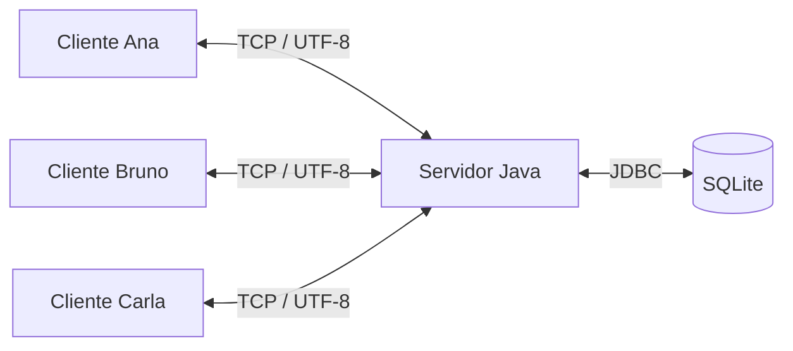

# Chat Java com Sockets e SQLite

Aplicação de chat no terminal em que vários clientes se conectam a um servidor
para trocar mensagens públicas e privadas. O projeto usa Java, sockets TCP,
streams UTF-8, multithreading e SQLite para persistir usuários e mensagens públicas.

## Sumário

- [Funcionalidades](#funcionalidades)
- [Estrutura do projeto](#estrutura-do-projeto)
- [Como o chat funciona](#como-o-chat-funciona)
- [Requisitos para executar](#requisitos-para-executar)
- [Executar pelo terminal](#executar-pelo-terminal)
- [Executar pelo IntelliJ IDEA](#executar-pelo-intellij-idea)
- [Comandos do chat](#comandos-do-chat)
- [Banco de dados SQLite](#banco-de-dados-sqlite)
- [Teste com três clientes](#teste-com-três-clientes)
- [Configurações do servidor](#configurações-do-servidor)
- [Compilação e execução com Maven](#compilação-e-execução-com-maven)
- [Problemas comuns](#problemas-comuns)

## Funcionalidades

| Requisito | Como foi implementado |
| --- | --- |
| Aplicação em Java | Classes compatíveis com JDK 17 ou superior |
| Comunicação cliente-servidor | `ServerSocket` no servidor e `Socket` em cada cliente |
| Streams | Leitura e escrita de texto UTF-8 usando os streams do socket |
| Clientes simultâneos | Uma tarefa de atendimento por conexão, executada por um pool de threads |
| Mensagens entre os participantes | Distribuição de mensagens públicas aos clientes conectados |
| Gestão de conexões | Nomes únicos durante a sessão, avisos de entrada e saída e remoção individual de clientes |
| Mensagens privadas | Comunicação entre remetente e destinatário com `/msg` |
| Persistência | Usuários e mensagens públicas armazenados em SQLite via JDBC |
| Histórico | Consulta das mensagens públicas, inclusive após reiniciar o servidor |

## Estrutura do projeto

```text
chat2/
├── banco/
│   ├── README.md
│   ├── consultas.sql
│   └── schema.sql
├── docs/
│   └── demonstracao.md
├── lib/
│   └── README.md
├── scripts/
│   ├── cliente.sh
│   ├── compilar.sh
│   ├── demonstrar.sh
│   ├── dependencias.sh
│   └── servidor.sh
├── src/main/java/br/edu/chat/
│   ├── banco/
│   │   └── BancoDados.java
│   ├── cliente/
│   │   └── ClienteChat.java
│   ├── compartilhado/
│   │   ├── CanalTexto.java
│   │   └── Protocolo.java
│   └── servidor/
│       ├── AtendimentoCliente.java
│       └── ServidorChat.java
├── .gitignore
├── pom.xml
└── README.md
```

### Responsabilidade de cada parte

| Arquivo ou pasta | Responsabilidade |
| --- | --- |
| `cliente/ClienteChat.java` | Conecta ao servidor, envia o que é digitado e exibe as mensagens recebidas |
| `servidor/ServidorChat.java` | Abre a porta TCP, aceita conexões, mantém os usuários online e encaminha mensagens |
| `servidor/AtendimentoCliente.java` | Atende uma conexão, valida o nome, interpreta os comandos e trata a desconexão |
| `compartilhado/CanalTexto.java` | Encapsula os streams do socket e sincroniza as escritas de mensagens |
| `compartilhado/Protocolo.java` | Define porta padrão, limites, validação dos nomes e texto de ajuda |
| `banco/BancoDados.java`, dentro de `src/` | Executa as operações JDBC de registro de usuários, gravação e consulta de mensagens |
| `banco/schema.sql`, na raiz | Define as tabelas e o índice criados automaticamente pelo servidor |
| `banco/consultas.sql`, na raiz | Contém consultas para visualizar usuários, histórico e contagem de mensagens |
| `scripts/dependencias.sh` | Baixa o driver SQLite JDBC e verifica seu SHA-256 |
| `scripts/compilar.sh` | Compila as classes, copia o esquema SQL e gera o JAR |
| `scripts/servidor.sh` | Compila e inicia o servidor |
| `scripts/cliente.sh` | Compila e inicia um cliente |
| `docs/demonstracao.md` | Contém o roteiro de apresentação manual |
| `pom.xml` | Configura a compilação com Maven, a dependência SQLite e o recurso SQL |
| `.gitignore` | Exclui do versionamento arquivos gerados, bancos locais e configurações do editor |

Estes arquivos e pastas são criados durante a utilização:

| Caminho | Quando aparece |
| --- | --- |
| `lib/sqlite-jdbc-3.53.4.0.jar` | Ao baixar a dependência pelos scripts |
| `build/classes/` | Ao compilar com os scripts |
| `build/chat.jar` | Ao compilar com os scripts |
| `target/` | Ao compilar com Maven |
| `dados/chat.db` | Ao iniciar o servidor com a configuração padrão |

O script `scripts/demonstrar.sh` ainda referencia
`src/test/java/br/edu/chat/demonstracao/DemonstracaoChat.java`, ausente nesta versão.
Para validar e apresentar o projeto, siga [Teste com três clientes](#teste-com-três-clientes).

## Como o chat funciona



### Conexão e identificação

1. O servidor abre um `ServerSocket` na porta `5000` e aguarda conexões.
2. Cada cliente abre um `Socket` para o endereço e a porta do servidor.
3. O servidor cria um `AtendimentoCliente`, executado em uma thread do pool.
4. A primeira linha enviada pelo cliente informa o nome do participante.
5. O servidor valida o nome, verifica se ele está disponível, registra o usuário
   no SQLite e avisa aos participantes que ele entrou.

Os nomes aceitam de 1 a 20 letras, números, `_` ou `-`, inclusive letras acentuadas.
Não são permitidos espaços. `Ana` e `ana` representam o mesmo nome. Um nome em uso
é rejeitado; após a desconexão, ele pode ser utilizado novamente. Não há autenticação
por senha. Se o nome for rejeitado, execute o cliente novamente e escolha outro.

### Envio e recebimento

Cada mensagem é uma linha de texto UTF-8. `CanalTexto` usa `InputStreamReader` e
`OutputStreamWriter`, com `BufferedReader` e `BufferedWriter`, para acessar os
streams do socket.

No cliente, a thread principal recebe e exibe as mensagens, enquanto uma thread
separada lê o teclado e envia os dados. Isso permite receber mensagens enquanto
o usuário está digitando.

No servidor, uma mensagem pública é gravada no SQLite e distribuída aos usuários
online, incluindo o remetente. Uma mensagem privada é enviada ao destinatário e
confirmada ao remetente, sem ser gravada no banco. Os clientes se comunicam pelo
servidor e não acessam diretamente o SQLite.

### Concorrência e desconexão

O `ExecutorService` executa os atendimentos simultaneamente. Os usuários online
ficam em um `ConcurrentHashMap`, com registro atômico para impedir nomes duplicados.
As escritas em um mesmo canal e o acesso à conexão JDBC são sincronizados.

Ao receber `/quit`, detectar o fim do stream ou uma falha de conexão, o atendimento
fecha o socket daquele cliente, remove seu nome da lista online e avisa os demais.
Os outros participantes podem continuar conversando. Uma perda de rede sem
fechamento imediato do TCP é detectada por erro de I/O ou pelo limite de inatividade.

## Requisitos para executar

- **JDK 17 ou superior**, com `java` e `javac` disponíveis.
- Para os scripts: **Bash** e, no primeiro download, **curl** e `sha256sum` ou `shasum`.
- Para executar pelo IntelliJ: importar o projeto como Maven e aguardar a resolução
  das dependências.
- Maven instalado somente se optar pelos comandos Maven no terminal.

Não é necessário instalar um servidor de banco de dados ou o executável `sqlite3`.
O driver JDBC inclui o SQLite. Após baixar as dependências, os scripts podem
executar a aplicação sem internet. Os scripts funcionam em ambientes Bash, como
Linux, macOS e WSL.

## Executar pelo terminal

Execute os comandos na raiz do projeto. Inicie primeiro o servidor:

```bash
bash scripts/servidor.sh
```

Em outro terminal, abra um cliente:

```bash
bash scripts/cliente.sh
```

Quando aparecer `Informe seu nome de usuário:`, digite um nome e pressione Enter.
Depois, digite mensagens ou comandos do chat. Repita o comando do cliente em
outros terminais para conectar mais participantes. Mantenha o servidor aberto.

### Usar outro endereço ou porta

Para iniciar o servidor na porta `6000`:

```bash
bash scripts/servidor.sh 6000
```

Para conectar um cliente no mesmo computador:

```bash
bash scripts/cliente.sh localhost 6000
```

Para conectar de outro computador, use o IP do servidor:

```bash
bash scripts/cliente.sh 192.168.1.10 6000
```

Substitua o IP pelo endereço real do servidor. Os computadores devem conseguir
acessar esse endereço e a porta escolhida na rede.

### Compilar e executar diretamente

Compile uma vez:

```bash
bash scripts/compilar.sh
```

No terminal do servidor:

```bash
java --enable-native-access=ALL-UNNAMED -cp 'build/classes:lib/*' br.edu.chat.servidor.ServidorChat
```

Em cada terminal de cliente:

```bash
java -cp build/classes br.edu.chat.cliente.ClienteChat
```

A compilação também gera `build/chat.jar`, que pode substituir `build/classes`
no classpath. O servidor precisa de `lib/*` para carregar o driver SQLite.

## Executar pelo IntelliJ IDEA

### Abrir e preparar

1. Acesse **File → Open**, selecione o `pom.xml` e escolha **Open as Project**.
2. Aguarde o Maven carregar as dependências. Se necessário, use a opção de recarregar
   os projetos na janela **Maven**.
3. Em **File → Project Structure → Project SDK**, selecione um JDK 17 ou superior.

O IntelliJ importa a dependência SQLite e o recurso SQL a partir do `pom.xml`.
Mais detalhes na [documentação de projetos Maven do IntelliJ](https://www.jetbrains.com/help/idea/maven-support.html).

### Iniciar o servidor

1. Abra `src/main/java/br/edu/chat/servidor/ServidorChat.java`.
2. Clique na seta verde ao lado de `main` e selecione **Run**.
3. Verifique a mensagem `Servidor iniciado na porta 5000. Aguardando clientes...`.
4. Deixe essa execução aberta.

Na configuração de execução do servidor, mantenha **Working directory** na raiz
do projeto para criar o banco em `dados/chat.db`. Em **Modify options → Add VM options**,
você pode informar as opções usadas pelos scripts:

```text
--enable-native-access=ALL-UNNAMED
```

Para usar outra porta, informe somente o número, por exemplo `6000`, em
**Program arguments**.

### Iniciar três clientes

1. Abra `src/main/java/br/edu/chat/cliente/ClienteChat.java` e execute seu `main`.
2. Clique no console do cliente, digite `Ana` e pressione Enter.
3. Em **Run → Edit Configurations**, selecione `ClienteChat`.
4. Habilite **Modify options → Allow multiple instances** e salve.
5. Execute a configuração `ClienteChat` mais duas vezes, sem encerrar as anteriores.
6. Informe `Bruno` no segundo cliente e `Carla` no terceiro.

Você terá quatro execuções abertas: um servidor e três clientes. Cada console
de cliente aceita mensagens e comandos independentemente. A opção **Allow multiple
instances** permite executar a mesma configuração simultaneamente, conforme a
[documentação de execução do IntelliJ](https://www.jetbrains.com/help/idea/run-debug-configuration-java-application.html).

Para conectar a outro endereço ou porta pelo IntelliJ, preencha **Program arguments**
do cliente com o host e a porta, por exemplo `localhost 6000`.

## Comandos do chat

Digite os comandos no console de um **cliente já identificado** e pressione Enter.

| Comando | Exemplo | Comportamento |
| --- | --- | --- |
| Texto sem `/` no início | `Olá, pessoal!` | Envia uma mensagem pública para todos, incluindo quem enviou |
| `/users` ou `/usuarios` | `/users` | Mostra a quantidade e os nomes dos participantes online |
| `/msg <nome> <mensagem>` | `/msg Bruno Olá, só para você!` | Envia uma mensagem privada e mostra uma confirmação ao remetente |
| `/history` ou `/historico` | `/history` | Exibe as últimas 10 mensagens públicas |
| `/history <quantidade>` ou `/historico <quantidade>` | `/historico 25` | Exibe de 1 a 50 mensagens públicas, da mais antiga à mais recente dentro da seleção |
| `/help` ou `/ajuda` | `/ajuda` | Exibe a ajuda dos comandos principais |
| `/quit` ou `/sair` | `/sair` | Encerra a conexão desse cliente |

### Exemplos de mensagens recebidas

Uma mensagem pública aparece com a data/hora e o autor:

```text
[2026-10-28 14:30:00] [Ana]: Olá, pessoal!
```

Uma mensagem privada aparece somente para os participantes envolvidos:

```text
[privado Ana -> Bruno]: Olá, só para você!
```

### Regras das mensagens e comandos

- Os comandos e a busca por destinatário não diferenciam maiúsculas de minúsculas.
- O destinatário de `/msg` precisa estar conectado.
- Mensagens privadas não aparecem no histórico e não são armazenadas no banco.
- Linhas em branco são ignoradas e os espaços nas extremidades são removidos.
- Cada linha enviada pelo cliente pode ter até 2.000 unidades de texto Java
  (`String.length()`), incluindo o comando quando houver.
- Quantidades inválidas em `/history`, comandos desconhecidos e destinatários
  ausentes geram uma mensagem de erro.
- O protocolo encerra uma conexão que envie uma linha de rede acima de 4.096
  unidades de texto Java.

## Banco de dados SQLite

O servidor cria automaticamente `dados/chat.db` e executa
[`banco/schema.sql`](banco/schema.sql). Não é necessário criar tabelas manualmente.

| Tabela | Campos | Finalidade |
| --- | --- | --- |
| `usuarios` | `id`, `nome`, `chave_nome`, `criado_em`, `ultimo_acesso` | Registra os participantes que já se conectaram |
| `mensagens` | `id`, `usuario_id`, `conteudo`, `enviada_em` | Armazena o autor, o conteúdo e o horário das mensagens públicas |

`mensagens.usuario_id` referencia `usuarios.id`: um usuário pode ter várias
mensagens. Reconectar com o mesmo nome reaproveita o usuário e atualiza o último
acesso. A lista de usuários online fica em memória; ter um registro no SQLite
não significa estar conectado.

O histórico permanece após reiniciar o servidor e é consultado com `/history`.
As mensagens usam o horário local do servidor; as datas de criação e acesso dos
usuários usam `CURRENT_TIMESTAMP` do SQLite, em UTC.

`BancoDados` usa `PreparedStatement` para enviar os valores das consultas. A conexão
JDBC é sincronizada, as chaves estrangeiras ficam habilitadas e o SQLite usa modo
WAL, com espera de até cinco segundos para bloqueios. Arquivos `.db-wal` e `.db-shm`
podem aparecer durante a execução como auxiliares do banco.

Para visualizar os dados, abra `dados/chat.db` em um visualizador SQLite. Se tiver
o utilitário `sqlite3` instalado, pode executar:

```bash
sqlite3 dados/chat.db < banco/consultas.sql
```

Veja também a [documentação da persistência](banco/README.md).

## Teste com três clientes

Inicie um servidor e mantenha **Ana, Bruno e Carla conectados simultaneamente**,
usando terminais ou as configurações do IntelliJ descritas acima.

| Etapa | Ação | Resultado esperado |
| --- | --- | --- |
| 1. Conexões simultâneas | Ana envia `/users` | A lista contém Ana, Bruno e Carla |
| 2. Mensagem pública | Ana envia `Olá, pessoal!` | Os três clientes recebem a mensagem |
| 3. Respostas | Bruno e Carla enviam mensagens | Todos recebem as respostas |
| 4. Mensagem privada | Ana envia `/msg Bruno Esta mensagem é privada.` | Apenas Ana e Bruno veem essa mensagem |
| 5. Saída normal | Carla envia `/quit` | Ana e Bruno recebem o aviso de saída |
| 6. Continuidade | Ana e Bruno continuam enviando mensagens | O chat permanece funcionando |
| 7. Reconexão | Execute outro cliente com o nome Carla | O servidor permite reutilizar o nome |
| 8. Queda do cliente | Encerre o processo de Carla | Os outros clientes continuam conversando |
| 9. Histórico | Ana envia `/history 50` | Aparecem as mensagens públicas recentes, sem a privada |
| 10. Persistência | Reinicie o servidor, reconecte um cliente e envie `/history 50` | O histórico anterior continua disponível |

Para conferir o tratamento de erros, tente conectar outro cliente como `ana`
enquanto Ana estiver online, envie `/msg Ausente teste` e envie `/history 0`.
O sistema deve informar o erro correspondente sem interromper os demais clientes.

Para a apresentação, mantenha os consoles dos três clientes disponíveis durante
as etapas iniciais. O [roteiro manual](docs/demonstracao.md#apresentação) detalha a
sequência de demonstração.

## Configurações do servidor

| Configuração | Padrão | Como informar |
| --- | --- | --- |
| Porta TCP | `5000` | Primeiro argumento do servidor, entre `1` e `65535` |
| Arquivo SQLite | `dados/chat.db` | `-Dchat.database=caminho/arquivo.db` |
| Espera por dados durante a identificação | `30` segundos | `-Dchat.handshake=30`, com valor maior que zero |
| Espera por dados após a identificação | `600` segundos | `-Dchat.idle=600`; use `0` para desativar |

Os tempos são configurados como limites de espera de leitura no socket. As opções
`-D` são opções da JVM e devem vir antes da classe principal. No IntelliJ, use o
campo **VM options** para elas.

Depois de compilar, este exemplo inicia o servidor na porta `6000`, usa outro
banco e desativa a desconexão por inatividade:

```bash
java --enable-native-access=ALL-UNNAMED -Dchat.database=dados/turma-b.db -Dchat.idle=0 -cp 'build/classes:lib/*' br.edu.chat.servidor.ServidorChat 6000
```

Use um arquivo SQLite por instância do servidor. Para encerrar, pressione Ctrl+C
no terminal ou pare a execução no IntelliJ. O servidor possui uma rotina de
fechamento da porta TCP, dos sockets dos clientes, do pool de threads e do banco.

## Compilação e execução com Maven

Com Maven disponível, compile e copie a dependência para `lib/`:

```bash
mvn package dependency:copy-dependencies -DoutputDirectory=lib
```

Inicie o servidor em um terminal:

```bash
java --enable-native-access=ALL-UNNAMED -cp 'target/classes:lib/*' br.edu.chat.servidor.ServidorChat
```

Em cada outro terminal, inicie um cliente:

```bash
java -cp target/classes br.edu.chat.cliente.ClienteChat
```

No PowerShell ou CMD, use `;` como separador do classpath e aspas duplas, por exemplo:

```text
java --enable-native-access=ALL-UNNAMED -cp "target/classes;lib/*" br.edu.chat.servidor.ServidorChat
```

## Problemas comuns

| Situação | O que verificar |
| --- | --- |
| Cliente não conecta | Inicie o servidor primeiro e confira o host e a porta |
| Porta já está em uso | Encerre o servidor anterior ou escolha outra porta e use a mesma nos clientes |
| Nome já está em uso | Escolha outro nome ou aguarde a desconexão da sessão anterior |
| IntelliJ encerra o cliente anterior ao abrir outro | Habilite **Allow multiple instances** na configuração `ClienteChat` |
| Erro de driver SQLite ou `No suitable driver` | Recarregue o Maven no IntelliJ; ao executar diretamente, inclua `lib/*` no classpath do servidor |
| Recurso `banco/schema.sql` não encontrado | Recompile pelos scripts ou pelo Maven; o esquema precisa ser copiado para o classpath |
| Banco aparece em outra pasta | Confira o **Working directory** da execução ou configure `chat.database` |
| Desconexão após ficar sem enviar dados | O limite padrão é dez minutos; ajuste `chat.idle` se necessário |
